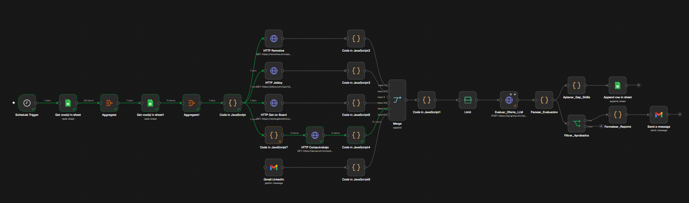
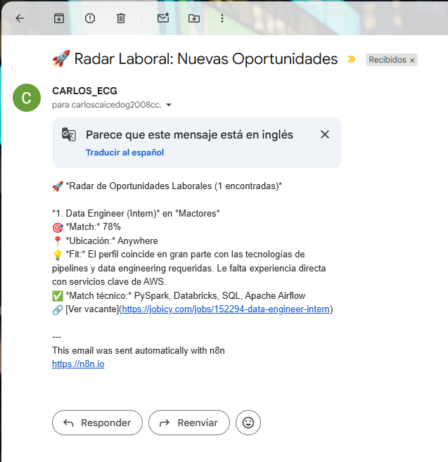

# Job Offer Scraper

Automatización en **n8n** que descubre vacantes (desde APIs públicas y alertas de LinkedIn), las filtra según un perfil profesional y unas preferencias guardadas en Google Sheets, evalúa cada oferta con un modelo de lenguaje (Groq) y envía un reporte por Gmail con las vacantes recomendadas.

## Tabla de contenidos

- [Qué hace](#qué-hace)
- [Arquitectura](#arquitectura)
- [Nodos principales](#nodos-principales)
- [Datos en Google Sheets](#datos-en-google-sheets)
- [Evaluación con Groq](#evaluación-con-groq)
- [Enviar reporte por Gmail](#enviar-reporte-por-gmail)
- [Workflow secundario: Agrupar Gap Skills](#workflow-secundario-agrupar-gap-skills)
- [Limitaciones conocidas](#limitaciones-conocidas)
- [Requisitos y configuración](#requisitos-y-configuración)

## Qué hace

El workflow se ejecuta automáticamente **lunes, miércoles, viernes y sábados a las 09:00** (zona horaria de la instancia de n8n). En cada ejecución:

1. Lee el perfil técnico (`Mi_Perfil`) y los filtros de búsqueda (`Filtros_Busqueda`) desde Google Sheets.
2. Construye, en un único nodo de código, las listas de roles deseados/rechazados, keywords rechazadas, ubicaciones válidas/rechazadas y un texto de perfil (ej. `Ingeniero de Sistemas. Habilidades técnicas: Python (Avanzado), SQL (Intermedio)...`).
3. Consulta en paralelo **cinco** fuentes de vacantes:
   - **Remotive** (API) — categoría `software-dev`.
   - **Jobicy** (API) — industria `engineering` (hasta 50 resultados).
   - **The Muse** (API) — categorías `Data and Analytics` y `Software Engineering`.
   - **Get on Board** (API) — categoría `programming` (hasta 50 resultados por página).
   - **LinkedIn (Gmail)** — lee los correos recientes de alertas de empleo enviados por `jobs-noreply@linkedin.com`.

   
4. Normaliza la respuesta de cada API a un esquema común (`id`, `fuente`, `titulo`, `empresa`, `url`, `ubicacion`, `descripcionLimpia`). Para el caso de **LinkedIn**, un nodo de código parsea el texto plano del correo usando expresiones regulares (Regex) para identificar los enlaces de las vacantes, y luego lee las líneas anteriores (hacia atrás) para extraer el título, la empresa y la ubicación, ignorando el ruido o texto de botones.
5. Une las **cinco** fuentes con un nodo `Merge` (5 entradas) y aplica los filtros de texto:
   - Descarta ubicaciones rechazadas y, si hay una lista de ubicaciones válidas, exige que la oferta coincida con alguna.
   - Descarta títulos con roles rechazados (ej. *senior*, *lead*).
   - Descarta ofertas cuyo título o descripción contenga alguna keyword rechazada.
   - Exige que el **título** contenga al menos uno de los roles deseados (no basta con que aparezca en la descripción).
6. Limita el lote resultante a un máximo de **40 ofertas**.
7. Envía cada oferta, una por una, a Groq (intervalo de 10 segundos entre solicitudes, con reintentos habilitados) para evaluar su compatibilidad con el perfil.
8. Parsea la respuesta de Groq y la combina con los datos originales de la vacante.
9. Guarda las habilidades faltantes detectadas en la hoja `Gap_Skills`.
10. Filtra las ofertas marcadas como `aplica = true` por el modelo y envía por Gmail un reporte con título, empresa, score, ubicación, resumen de fit y habilidades coincidentes.

Si la lista `Roles_Deseados` llega vacía desde Sheets, el flujo corta la ejecución y devuelve una alerta en lugar de procesar ofertas, para evitar falsos positivos.

## Arquitectura



El flujo comienza leyendo el perfil y los filtros en Google Sheets, construye las listas de filtrado y el texto de perfil. Luego, dispara en paralelo las cuatro consultas a las APIs de empleo y la lectura de correos de LinkedIn vía Gmail. Cada resultado se normaliza al mismo esquema, se combina con `Merge`, se filtra por texto y se limita a 40 ofertas antes de pasar por Groq. Finalmente, registra las brechas de habilidades detectadas y envía por Gmail las ofertas aprobadas.

### Nodos principales

| Nodo | Responsabilidad |
| --- | --- |
| `Schedule Trigger` | Inicia la automatización 4 veces por semana (lun/mié/vie/sáb, 09:00). |
| `Get row(s) in sheet` / `Aggregate` | Lee y agrupa la hoja `Mi_Perfil`. |
| `Get row(s) in sheet1` / `Aggregate1` | Lee y agrupa la hoja `Filtros_Busqueda`. |
| `Code in JavaScript` | Construye las listas de roles/keywords/ubicaciones y el texto del perfil (`perfilString`). Corta el flujo con una alerta si `Roles_Deseados` viene vacío. |
| `HTTP Remotive`, `HTTP Jobicy`, `HTTP The Muse`, `HTTP Get on Board` | Obtienen vacantes desde las cuatro APIs externas. |
| `Gmail` | Obtiene los correos recientes de `jobs-noreply@linkedin.com` usando el filtro de búsqueda nativo. |
| `Code in JavaScript2,3,4,5` (APIs) y `Code` (Parseador LinkedIn) | Normalizan cada fuente al mismo esquema. El parseador de LinkedIn usa Regex y contexto de líneas para extraer vacantes limpias del texto del correo. |
| `Merge` | Une las **cinco** fuentes normalizadas (5 entradas). |
| `Code in JavaScript1` | Aplica los filtros de ubicación, rol rechazado, keyword rechazada y rol deseado; arma el objeto final de cada oferta aprobada. |
| `Limit` | Reduce el lote a 40 ofertas como máximo. |
| `Evaluar_Oferta_LLM` | Envía cada oferta a Groq (lote de 1, cada 10 s) y solicita un JSON con score, aplicabilidad, resumen y brechas. |
| `Parsear_Evaluacion` | Parsea el JSON de Groq y lo combina con los datos originales de la vacante (tomados de `Limit`). |
| `Aplanar_Gap_Skills` / `Append row in sheet` | Convierte cada habilidad faltante en una fila y la agrega a `Gap_Skills`. |
| `Filtrar_Aprobados` | Nodo `If` que conserva solo las ofertas con `aplica === true`. |
| `Formatear_Reporte` | Arma el cuerpo del correo con las ofertas aprobadas (o un mensaje de "sin resultados"). |
| `Send a message` | Envía el reporte por Gmail. |

## Datos en Google Sheets

El workflow utiliza el documento `job-offer-scraper` con estas hojas:

### `Mi_Perfil`

Debe tener, como mínimo, las columnas:

| Columna | Uso |
| --- | --- |
| `Habilidad` | Nombre de la habilidad técnica. |
| `Nivel` | Nivel declarado para esa habilidad. Si se omite, el workflow asume `Intermedio`. |

Cada fila se convierte a un elemento como `Python (Avanzado)`, y todas se concatenan en un único texto de perfil que se envía al evaluador de Groq (con el prefijo fijo "Ingeniero de Sistemas.").

### `Filtros_Busqueda`

Debe tener, como mínimo, las columnas:

| Columna | Uso |
| --- | --- |
| `Roles_Deseados` | Términos que deben aparecer en el título de la oferta. **Obligatoria**: si llega vacía, el flujo se detiene con una alerta. |
| `Roles_Rechazados` | Términos de cargos que deben excluirse del título (ej. *senior*, *lead*). |
| `Keywords_Rechazadas` | Términos que deben excluirse del título o la descripción. |
| `Ubicaciones_Validas` | Ubicaciones aceptadas; si la columna tiene valores, solo pasan ofertas que coincidan. |
| `Ubicaciones_Rechazadas` | Ubicaciones que descartan la oferta directamente. |

Los valores se leen fila por fila, se separan por comas y se normalizan a minúsculas.

### `Gap_Skills`

El workflow agrega las columnas `Habilidad_Faltante`, `Conteo` y `Ultima_Vez_Vista`. En el estado actual, `Conteo` se escribe como `1` en cada ejecución y **no se consolida automáticamente** por habilidad (cada corrida agrega filas nuevas en lugar de sumar sobre una fila existente).

## Evaluación con Groq

El nodo `Evaluar_Oferta_LLM` llama al endpoint `https://api.groq.com/openai/v1/chat/completions` (compatible con la API de OpenAI) usando el modelo **`openai/gpt-oss-120b`**, con `temperature = 0.1`, `max_tokens = 700` y `response_format: json_object`. Solicita una respuesta con esta forma:

```json
{
  "aplica": true,
  "match_score": 0,
  "resumen_fit": "",
  "habilidades_coincidentes": [],
  "habilidades_faltantes": []
}
```

El propio prompt instruye al modelo a marcar `aplica = true` únicamente cuando `match_score >= 65`; el nodo `Filtrar_Aprobados` simplemente confía en el valor booleano `aplica` devuelto por Groq (no vuelve a comparar el score en n8n). El lote se procesa **de una oferta a la vez**, con un intervalo de 10 segundos entre solicitudes y reintentos automáticos habilitados.

## Enviar reporte por Gmail

El nodo `Send a message` envía el reporte generado por `Formatear_Reporte` a la casilla configurada. Así se ve un correo recibido:



## Workflow secundario: Agrupar Gap Skills

Además del workflow principal, el repositorio incluye un segundo workflow de n8n — **`Agrupar Gap Skills`** (`n8n/Workflow-agrupar.json`) — cuyo único propósito es consolidar la hoja `Gap_Skills` que va acumulando filas sueltas en cada ejecución del scraper.

### Qué hace

1. Se dispara con el mismo `Schedule Trigger` que el workflow principal (lunes, miércoles, viernes y sábados a las 09:00).
2. Lee **todas** las filas actuales de `Gap_Skills`.
3. Agrupa las filas por `Habilidad_Faltante`: suma los valores de `Conteo` y conserva la fecha más reciente de `Ultima_Vez_Vista`. El resultado se ordena de mayor a menor `Conteo`, dejando primero las habilidades más demandadas.
4. Borra todas las filas existentes en `Gap_Skills` (hasta 1000 filas; si el borrado falla, el workflow continúa igualmente).
5. Vuelve a leer el resultado agrupado (rescatado desde el nodo de agrupación) y lo reinserta en `Gap_Skills`, ahora con una sola fila por habilidad y su conteo consolidado.

### Nodos principales

| Nodo | Responsabilidad |
| --- | --- |
| `Schedule Trigger` | Dispara la consolidación (mismo horario que el workflow principal). |
| `Get row(s) in sheet` | Lee todas las filas actuales de `Gap_Skills`. |
| `Code in JavaScript` | Agrupa por `Habilidad_Faltante`, suma `Conteo`, conserva la `Ultima_Vez_Vista` más reciente y ordena de mayor a menor conteo. |
| `Delete rows or columns from sheet` | Borra hasta 1000 filas de `Gap_Skills` (`executeOnce`, continúa aunque falle). |
| `Code in JavaScript1` | Recupera el resultado ya agrupado del primer nodo de código para reinsertarlo. |
| `Append row in sheet` | Reescribe `Gap_Skills` con una fila consolidada por habilidad. |

## Limitaciones conocidas

- **Sin deduplicación de ofertas entre ejecuciones**: el workflow principal no guarda qué ofertas ya se reportaron, por lo que una misma vacante puede aparecer en varios envíos si sigue publicada.